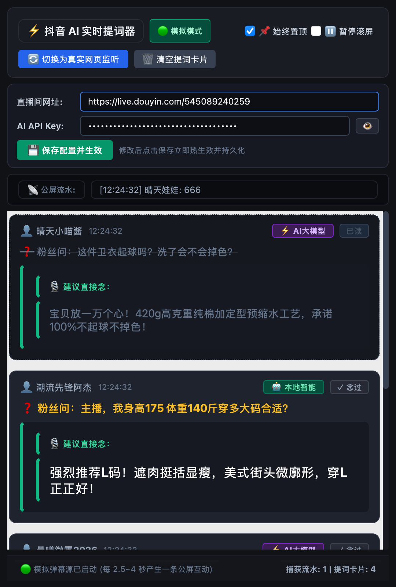

# 抖音直播 AI 实时提词器 (Live Teleprompter Pro)

专为主播设计的单向只读 AI 实时口播提词器桌面客户端。  
通过监听直播间粉丝公屏弹幕，自动过滤低价值水弹幕，结合电商背景知识库通过 AI 秒级生成 45 字以内的自然口播台词，以大字号高对比度置顶悬浮窗供主播看着念。

> **纯只读安全承诺**：本工具绝不包含任何自动发评论、模拟点击、账号登录或公屏回发互动功能，完全单向只读。

---

## 📸 运行效果预览 (Preview)

<p align="center">
  
</p>

---

## 🌟 核心特性
1. **双模式弹幕源**：
   - **模拟模式（默认开启）**：每隔 2.5~4 秒自动生成仿真水弹幕与真实商品疑问，零成本本地调试。
   - **真实模式（Playwright 无头监听）**：实时抓取指定抖音直播间网页公屏聊天区 DOM 数据。
2. **二级初筛与智能问答**：
   - **第一级（本地规则）**：毫秒级过滤纯数字、少于3字及无效水弹幕，大幅降低 Token 消耗。
   - **第二级（AI 决策）**：基于注入的知识库生成主播口播回答；若非问题自动忽略。
   - **无 Key 智能降级**：未配置 API Key 时自动启用内置规则引擎，自动识别尺码/身高/体重/物流/运费险。
3. **专业主播 UI（PyQt6）**：
   - 深色高对比度（深黑底色 + 黄色高亮粉丝提问 + 大号白色口播台词）。
   - 窗口始终置顶、暂停自动滚动、一键模式切换、已念标记划线等。

---

## 🚀 快速启动指南

### 1. 环境准备
推荐使用 Python 3.10 ~ 3.13。

```bash
# 1. 创建虚拟环境 (可选)
python -m venv .venv

# 2. 激活虚拟环境
# macOS / Linux:
source .venv/bin/activate
# Windows:
.venv\Scripts\activate

# 3. 安装项目依赖
pip install -r requirements.txt

# 4. (如需真实网页监听模式) 安装 Playwright 浏览器内核
playwright install chromium
```

## 🚀 Windows 极速启动与排错指南

针对国内网络环境，本项目全套脚本已默认配置**阿里云镜像 (npmmirror) 与清华 PyPI 源**，无需配置代理即可秒速下载。

### 步骤一：清理旧缓存（如之前下载中断或卡死）
直接双击运行：
👉 **`1_清理缓存.bat`** (或 `clean_cache.bat`)
- 自动强行终止卡死的 Python/Node 残留进程
- 彻底清空 `%LOCALAPPDATA%\ms-playwright` 损坏的半成品缓存与项目临时文件

### 步骤二：安装浏览器内核（国内镜像加速）
双击运行：
👉 **`2_安装浏览器内核.bat`** (或 `install_browser.bat`)
- 通过阿里云镜像高速拉取 Chromium 浏览器内核（约 140MB）
- 10~30 秒内跑完 100% 进度条并提示成功

### 步骤三：启动提词器
双击运行：
👉 **`3_启动提词器.bat`** (或 `start.bat`)
- 静默无终端黑框启动提词器客户端，可随时点击【🔄 切换为真实网页监听】

### 步骤四（可选）：一键打包独立 EXE
双击运行：
👉 **`4_打包EXE.bat`** (或 `build_exe.bat`)
- 自动生成 `dist\抖音直播AI提词器\抖音直播AI提词器.exe`，免安装即开即用！

---

## ⚙️ 核心配置说明 (`config.py`)

在提词器界面顶部已支持**可视化修改并实时保存生效**；亦可在 `config.py` 中直接编辑：
- `MOCK_MODE`: 默认 `True`（模拟仿真），设为 `False` 即为真实监听。
- `DOUYIN_ROOM_URL`: 要监听的抖音直播间网址。
- `AI_API_KEY`: 大模型 API Key（留空则自动启用本地智能话术兜底）。
- `OPENAI_BASE_URL`: API 地址（支持 DeepSeek / 通义千问 / 月之暗面等兼容接口）。
- `SYSTEM_KNOWLEDGE_BASE`: 直播间知识库（商品卖点、面料工艺、尺码推荐对照表、物流发货时效、售后优惠等）。

---

## 📁 文件结构
```text
Live_Teleprompter_Pro/
├── assets/
│   └── preview.png        # 提词器实际运行效果预览图
├── README.md              # 项目说明文档
├── build_exe.bat          # Windows 一键打包 EXE 脚本
├── 启动提词器.bat          # Windows 一键静默启动快捷脚本
├── 一键安装环境并启动.bat  # Windows 首次一键安装依赖并运行
├── requirements.txt       # 依赖声明
├── config.py              # 全局配置与背景知识库 (支持动态持久化)
├── danmu_listener.py      # QThread 双模式弹幕监听器
├── ai_brain.py            # 本地规则初筛 + 大模型问答 + 本地降级
└── main.py                # PyQt6 独立置顶提词器界面
```
